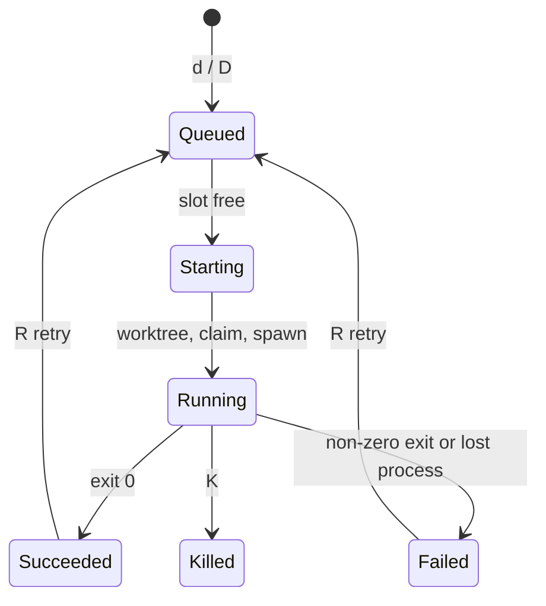

<p align="center">
  
</p>

<h1 align="center">abacus</h1>

<p align="center">A terminal UI for a <a href="https://github.com/gastownhall/beads">beads</a> graph that dispatches <a href="https://omp.sh">omp</a> agents onto beads.</p>

abacus shows every bead in a repo, including its parent/child hierarchy, its `blocks` edges, and whether it is ready. With one key it queues headless `omp` runs that work beads in their own git worktrees. Runs keep going after you quit, and abacus picks them back up on the next launch.

## Install

abacus builds from source with Cargo. You need a Rust toolchain at 1.88 or newer, installed with [rustup](https://rustup.rs).

```console
$ git clone git@github.com:mlg87/abacus.git && cd abacus
$ cargo install --locked --path .
$ abacus --version
abacus 0.1.0
```

`--locked` makes Cargo build with the exact dependency versions in `Cargo.lock`. Without it, `cargo install` resolves dependencies again and can build a different binary.

Cargo puts the binary in `~/.cargo/bin`. The rustup installer adds that directory to your `PATH` through `~/.cargo/env`. If your shell says `abacus: command not found`, add this line to your shell profile (for example `~/.zshrc`) and open a new terminal:

```sh
. "$HOME/.cargo/env"
```

To update, run `git pull` and then `cargo install --locked --path .` again. To remove abacus, run `cargo uninstall abacus`.

### Runtime requirements

abacus calls these tools, so they must be on your `PATH`:

| Tool | Needed for | Tested with |
|---|---|---|
| [`bd`](https://github.com/gastownhall/beads) | Reading and claiming beads. abacus does not start without it. | 1.2.2 |
| `git` | Worktrees and branches. abacus does not start without it. | 2.50.1 |
| [`omp`](https://omp.sh) | Running agents. Change it with `--agent-cmd`. | 18.12.3 |
| [`gh`](https://cli.github.com) | Only when a dispatch creates an issue-linked branch. | 2.97.0 |

## Quickstart

```console
$ cd ~/workspace/dlb   # any repo with a .beads/ directory
$ abacus
```

You can also run `abacus --repo <path>` from anywhere.

## What the views show

| Key | View | Shows |
|---|---|---|
| <kbd>1</kbd> | Tree | Hierarchy with status glyphs, `[closed/total]` child counts, `#N` issue badges, and run badges, beside a detail pane with relationships, the latest run, description, and notes. |
| <kbd>2</kbd> | Graph | Beads in columns by dependency layer over `blocks` edges, scoped to the selection's subtree (`Local`) or everything open (`AllOpen`). Cycles get their own column. |
| <kbd>3</kbd> | Agents | Every run with its state, elapsed time, cost, and current activity or `RESULT:` line, plus the selected run's live log. |

Status glyphs match `bd graph`: `○` ready, `●` blocked, `◐` in progress, `❄` deferred, `✓` closed. Readiness is stricter than `bd ready`, which only looks at a bead's own `blocks` edges and so lists an epic as ready even when nothing under it can start. An open bead is ready in abacus when all of these hold:

- every `blocks` target of the bead is closed;
- no ancestor is blocked by status or by an open `blocks` target, since that dependency also holds back everything below the ancestor;
- if the bead has open children, at least one of them is ready.

An open parent whose remaining children are only in progress or blocked shows `◐` if any child is in progress, and `●` if none is. The detail pane names the cause of a block: the open blockers, the blocked ancestor, or "no open child is ready".

## How dispatch works

Mark beads with <kbd>space</kbd>, then press <kbd>d</kbd> (or <kbd>D</kbd> to decompose). A confirm dialog shows the mode for each bead, or why it is skipped.

| Mode | Picked for | Worktree and branch | The agent |
|---|---|---|---|
| resolve | epic with a `gh-N` ref | `<repo>-<N>-<slug>` on `<N>-<slug>`, created through `gh issue develop` | decomposes if needed, implements the children in dependency order, and opens one PR that closes `#N` |
| implement | any other bead | `<repo>-<N>-<id>-<slug>` under a GitHub epic, otherwise `<repo>-bead-<id>-<slug>` | implements that bead only and opens a PR |
| decompose | epic, via <kbd>D</kbd> | detached scratch checkout under the state dir | creates the missing child beads with `bd create --graph`, changing no files |

Before a run starts, abacus claims the bead (`bd update --claim`). It refuses a bead that is not ready, that already has an active run, or that sits inside an active resolve run. At most `--max-concurrent` agents run at once; the rest wait in a queue.



## Options

| Flag | Default | Purpose |
|---|---|---|
| `--repo <path>` | `.` | Any directory in a repo with `.beads/`. Worktrees resolve to the primary checkout. |
| `--max-concurrent <n>` | `3` | Agents running at once. |
| `--model <model>` | omp's default | Passed to the agent as `--model`. |
| `--agent-cmd <cmd>` | `omp` | Agent executable. It must accept omp's headless flags. |
| `--state-dir <path>` | `~/.local/state/abacus` | Run logs, sessions, and scratch worktrees. Also set by `ABACUS_STATE_DIR`. |

Each run lives in `<state-dir>/runs/<run-id>/`: `meta.json`, `prompt.md`, `events.jsonl` (agent stdout), `stderr.log`, `exit_code`, and the omp `session/`. In the Agents view, <kbd>o</kbd> reopens a finished run's session in a new iTerm tab with `omp --continue`.

<details>
<summary><b>All key bindings</b></summary>

| Where | Keys | Action |
|---|---|---|
| Everywhere | <kbd>f</kbd> / <kbd>L</kbd> / <kbd>/</kbd> | Cycle status filter / cycle label filter / search |
| Everywhere | <kbd>r</kbd>, <kbd>?</kbd>, <kbd>q</kbd> | Reload, help, quit (running agents keep running) |
| Tree | <kbd>→</kbd> <kbd>←</kbd>, <kbd>e</kbd> / <kbd>E</kbd> | Expand or collapse, all or none |
| Tree | <kbd>Tab</kbd> | Focus the detail pane; <kbd>Enter</kbd> jumps to the highlighted relationship |
| Tree, Graph | <kbd>space</kbd>, <kbd>d</kbd>, <kbd>D</kbd> | Mark, dispatch, decompose |
| Graph | <kbd>Enter</kbd> / <kbd>Backspace</kbd>, <kbd>s</kbd> | Drill in / back up, toggle scope |
| Agents | <kbd>K</kbd>, <kbd>R</kbd>, <kbd>X</kbd> | Kill (or cancel a queued run), retry, release the bead back to open |
| Agents | <kbd>o</kbd>, <kbd>C</kbd>, <kbd>Enter</kbd> | Open session, hide ended runs, jump to the bead |

</details>

## Brand assets

| File | Use |
|---|---|
| [`assets/abacus-logo.svg`](assets/abacus-logo.svg) | Full mark on its dark tile, with the bead rod. For READMEs and avatars. |
| [`assets/abacus-mark.svg`](assets/abacus-mark.svg) | Mark only, transparent. For small sizes and light backgrounds. |

The TUI chrome uses the mark's gradient stops, defined in [`src/ui/theme.rs`](src/ui/theme.rs): coral `#FD5A6F`, magenta `#FF4FF0`, violet `#AF80FD`, and cyan `#00E5FF`. Bead status colours stay semantic, matching `bd graph`.
