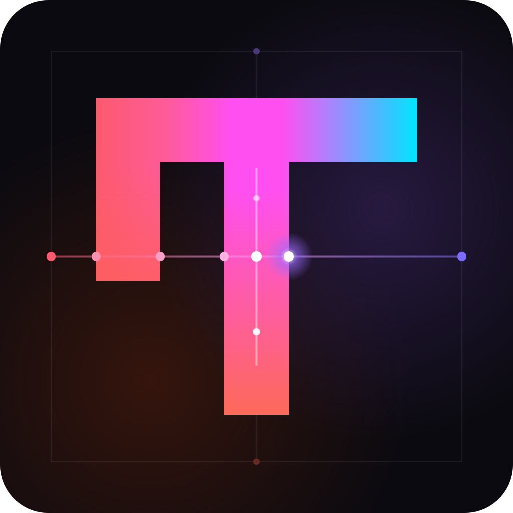
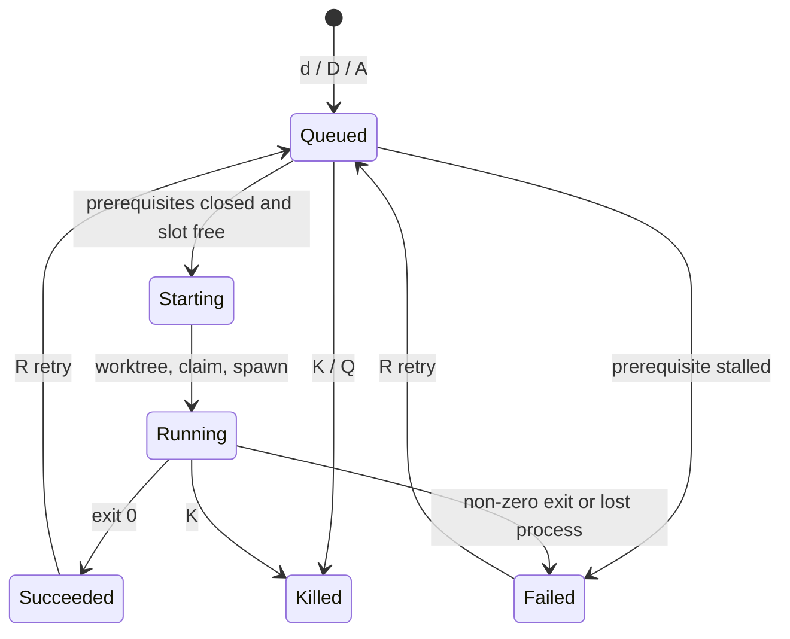

<p align="center">
  
</p>

<h1 align="center">abacus</h1>

<p align="center">A terminal UI for a <a href="https://github.com/gastownhall/beads">beads</a> graph that dispatches <a href="https://omp.sh">omp</a> agents onto beads.</p>

abacus shows every bead in a repo, including its parent/child hierarchy, its `blocks` edges, and whether it is ready. With one key it queues headless `omp` runs that work beads in their own git worktrees. Runs keep going after you quit, and abacus picks them back up on the next launch.

## Install

abacus builds from source with Cargo. You need a Rust toolchain at 1.88 or newer, installed with [rustup](https://rustup.rs).

```console
$ git clone git@github.com:mlg87/abacus.git && cd abacus
$ cargo install --locked --path .
$ abacus --version
```

`--locked` makes Cargo build with the exact dependency versions in `Cargo.lock`. Without it, `cargo install` resolves dependencies again and can build a different binary.

Cargo puts the binary in `~/.cargo/bin`. The rustup installer adds that directory to your `PATH` through `~/.cargo/env`. If your shell says `abacus: command not found`, add this line to your shell profile (for example `~/.zshrc`) and open a new terminal:

```sh
. "$HOME/.cargo/env"
```

To update, press <kbd>U</kbd> in abacus when its bottom bar offers a newer release (see [Releases and updates](#releases-and-updates)). You can also run `git pull` and then `cargo install --locked --path .` again. To remove abacus, run `cargo uninstall abacus`.

### Runtime requirements

abacus calls these tools, so they must be on your `PATH`:

| Tool | Needed for | Tested with |
|---|---|---|
| [`bd`](https://github.com/gastownhall/beads) | Reading and claiming beads. abacus does not start without it. | 1.2.2 |
| `git` | Worktrees and branches. abacus does not start without it. | 2.50.1 |
| [`omp`](https://omp.sh) | Running agents. Change it with `--agent-cmd`. | 18.12.3 |
| [`gh`](https://cli.github.com) | Only when a dispatch creates an issue-linked branch. | 2.97.0 |

## Quickstart

```console
$ cd ~/workspace/dlb   # any repo with a .beads/ directory
$ abacus
```

You can also run `abacus --repo <path>` from anywhere.

## What the views show

| Key | View | Shows |
|---|---|---|
| <kbd>1</kbd> | Tree | Hierarchy with status glyphs, `[closed/total]` child counts, `#N` issue badges, and run badges, beside a detail pane with relationships, the latest run, description, and notes. |
| <kbd>2</kbd> | Graph | Beads in columns by dependency layer over `blocks` edges, scoped to the selection's subtree (`Local`) or everything open (`AllOpen`). Cycles get their own column. |
| <kbd>3</kbd> | Agents | Every run with its state, elapsed time, cost, and current activity or `RESULT:` line, plus the selected run's live log. |

Status glyphs match `bd graph`: `○` ready, `●` blocked, `◐` in progress, `❄` deferred, `✓` closed. Readiness is stricter than `bd ready`, which only looks at a bead's own `blocks` edges and so lists an epic as ready even when nothing under it can start. An open bead is ready in abacus when all of these hold:

- every `blocks` target of the bead is closed;
- no ancestor is blocked by status or by an open `blocks` target, since that dependency also holds back everything below the ancestor;
- if the bead has open children, at least one of them is ready.

An open parent whose remaining children are only in progress or blocked shows `◐` if any child is in progress, and `●` if none is. The detail pane names the cause of a block: the open blockers, the blocked ancestor, or "no open child is ready". The <kbd>?</kbd> help opens with this legend.

Siblings in the tree are ordered by dependency (blockers first), then priority, then age, with closed beads last.

## How dispatch works

Mark beads with <kbd>space</kbd>, then press <kbd>d</kbd> (or <kbd>D</kbd> to decompose). A confirm dialog shows the mode for each bead, or why it is skipped.

| Mode | Picked for | Worktree and branch | The agent |
|---|---|---|---|
| resolve | epic with a `gh-N` ref | `<repo>-<N>-<slug>` on `<N>-<slug>`, created through `gh issue develop` | decomposes if needed, implements the children in dependency order, and opens one PR that closes `#N` |
| implement | any other bead | `<repo>-<N>-<id>-<slug>` under a GitHub epic, otherwise `<repo>-bead-<id>-<slug>` | implements that bead only and opens a PR |
| decompose | epic, via <kbd>D</kbd> | detached scratch checkout under the state dir | creates the missing child beads with `bd create --graph`, changing no files |

Before a run starts, abacus claims the bead (`bd update --claim`). It refuses a bead that already has an active run or that sits inside an active resolve run. At most `--max-concurrent` agents run at once; the rest wait in a queue.

Dispatching a blocked bead queues its prerequisites instead of refusing it. abacus walks the open beads that block it, its ancestors, or its open children, and does the same for each of those that is blocked in turn. It queues every bead in dependency order, with the original bead last. The dialog shows what each one waits for (`after …`). A queued run starts once every bead it waits on has closed, so independent prerequisites run in parallel up to `--max-concurrent`. A bead that a running or queued run already covers is waited on, not dispatched again. The chain is all or nothing: if any prerequisite cannot be dispatched (a manual `blocked` status, a dependency cycle, an epic without a `gh-N` ref), the original bead is skipped with that reason. While a prerequisite's run is going, or its last run opened a PR, the runs after it keep waiting. When a prerequisite is still open after its last run ended without a PR, they fail with `skipped: prerequisite …`.

<kbd>A</kbd> in the tree dispatches all ready work at once. It takes every `○` bead without open children that the current filters (status, label, search) match, and leaves out beads that a running or queued run already covers or whose PR is awaiting merge. A ready epic is not dispatched itself; its ready children are, so they can run in parallel. The queue order is highest priority first. Among beads of equal priority, the one whose close would unblock the most beads goes first: the beads that would stop showing `●` at once, counting the children of an epic it gates. The dialog shows each bead's priority and that count. Runs start in this order as slots free up.

When a run ends (succeeded, failed, or killed), abacus hands its claim back. It reopens the bead if it is still `in_progress`, and so stays dispatchable. For a resolve run it also reopens children the agent claimed. A bead the agent closed stays closed. Claims from runs that ended while abacus was not running are released at the next launch.

The queue lives in memory. Quitting drops it (abacus asks first), and <kbd>Q</kbd> in the Agents view drains it, cancelling every queued run.



## Deleting a bead

<kbd>X</kbd> in the tree or graph deletes the selected bead and its descendants after a confirm dialog that lists the beads it currently blocks. `bd delete` removes every dependency link touching the deleted beads, so those beads lose the blocker and show as ready once nothing else holds them. abacus refuses while the bead, a descendant, or an ancestor's resolve run is active. Deletion cannot be undone.

## Options

| Flag | Default | Purpose |
|---|---|---|
| `--repo <path>` | `.` | Any directory in a repo with `.beads/`. Worktrees resolve to the primary checkout. |
| `--max-concurrent <n>` | `3` | Agents running at once. |
| `--model <model>` | omp's default | Passed to the agent as `--model`. |
| `--agent-cmd <cmd>` | `omp` | Agent executable. It must accept omp's headless flags. |
| `--state-dir <path>` | `~/.local/state/abacus` | Run logs, sessions, and scratch worktrees. Also set by `ABACUS_STATE_DIR`. |

Each run lives in `<state-dir>/runs/<run-id>/`: `meta.json`, `prompt.md`, `events.jsonl` (agent stdout), `stderr.log`, `exit_code`, and the omp `session/`. In the Agents view, <kbd>o</kbd> reopens a finished run's session in a new iTerm tab with `omp --continue`.

<details>
<summary><b>All key bindings</b></summary>

| Where | Keys | Action |
|---|---|---|
| Everywhere | <kbd>f</kbd> / <kbd>L</kbd> / <kbd>/</kbd> | Cycle status filter / cycle label filter / search |
| Everywhere | <kbd>r</kbd>, <kbd>?</kbd>, <kbd>q</kbd> | Reload, help, quit (running agents keep running) |
| Everywhere | <kbd>U</kbd> | Install the newer release that the bottom bar offers |
| Tree | <kbd>→</kbd> <kbd>←</kbd>, <kbd>e</kbd> / <kbd>E</kbd> | Expand or collapse, all or none |
| Tree | <kbd>Tab</kbd> | Focus the detail pane; <kbd>Enter</kbd> jumps to the highlighted relationship |
| Tree | <kbd>A</kbd> | Dispatch every ready bead the filters match, by priority, then beads unblocked |
| Tree, Graph | <kbd>space</kbd>, <kbd>d</kbd>, <kbd>D</kbd>, <kbd>X</kbd> | Mark, dispatch, decompose, delete |
| Graph | <kbd>Enter</kbd> / <kbd>Backspace</kbd>, <kbd>s</kbd> | Drill in / back up, toggle scope |
| Agents | <kbd>K</kbd>, <kbd>R</kbd>, <kbd>Q</kbd> | Kill (or cancel a queued run), retry, drain the queue |
| Agents | <kbd>o</kbd>, <kbd>C</kbd>, <kbd>Enter</kbd> | Open session, hide ended runs, jump to the bead |

</details>

## Releases and updates

The top bar shows the version you are running, next to the name. When a merge to `main` changes the version in `Cargo.toml`, CI tags that commit `vX.Y.Z` and publishes a [GitHub release](https://github.com/mlg87/abacus/releases) with generated notes.

abacus looks for a newer release at launch and then every hour. It lists the repository's tags with `git ls-remote`, so the check needs no GitHub token. When it finds a newer release, the bottom bar starts with <kbd>U</kbd> `update to vX.Y.Z`. Press <kbd>U</kbd> and confirm, and abacus runs this in the background:

```sh
cargo install --locked --git https://github.com/mlg87/abacus --tag vX.Y.Z
```

The build takes a few minutes. Its output goes to `<state-dir>/update.log`, and running agents keep running. If you installed abacus into another Cargo root with `--root`, the update goes into that root too. When the install finishes, the bottom bar says so. Quit and relaunch abacus to use the new version. If the build fails, the offer stays up so you can try again.

## Brand assets

| File | Use |
|---|---|
| [`assets/abacus-logo.svg`](assets/abacus-logo.svg) | Full mark on its dark tile, with the bead rod. For READMEs and avatars. |
| [`assets/abacus-mark.svg`](assets/abacus-mark.svg) | Mark only, transparent. For small sizes and light backgrounds. |

The TUI chrome uses the mark's gradient stops, defined in [`src/ui/theme.rs`](src/ui/theme.rs): coral `#FD5A6F`, magenta `#FF4FF0`, violet `#AF80FD`, and cyan `#00E5FF`. Bead status colours stay semantic, matching `bd graph`.

## Contributing

A PR to `main` merges only when these checks pass:

| Check | Passes when |
|---|---|
| `test` | `cargo test --locked` passes. |
| `coverage` | Line coverage from `cargo-llvm-cov` is at least the base commit's. Coverage only goes up. |
| `conventional commits` | The PR title and every commit except merge commits follow [Conventional Commits](https://www.conventionalcommits.org): `<type>[(scope)][!]: <description>`. The type is one of `build`, `chore`, `ci`, `docs`, `feat`, `fix`, `perf`, `refactor`, `revert`, `style`, or `test`. |
| `version` | `Cargo.toml` raises the version by the largest bump that the PR's commits and title call for. |

| Largest change in the PR | Bump | From 0.2.0 |
|---|---|---|
| `!` after the type, or a `BREAKING CHANGE:` footer | major | 1.0.0 |
| `feat` | minor | 0.3.0 |
| `fix` or `perf` | patch | 0.2.1 |
| any other type | none | 0.2.0 |

The PR sets the version itself, because CI never pushes to `main`. After you edit `version` in `Cargo.toml`, run `cargo update --workspace` so `Cargo.lock` matches. `cargo test --locked` fails if it does not. If another PR releases while yours is open, merge `main` into your branch, and the `version` check names the next version. If two PRs merge with the same version, the release job warns, and the second PR's changes go out with the next release.

To run the checks locally:

```sh
scripts/conventional-commits.sh lint origin/main HEAD
scripts/conventional-commits.sh version origin/main HEAD
scripts/coverage-ratchet.sh origin/main
```

The coverage script needs `jq` and `cargo-llvm-cov`. To install `cargo-llvm-cov`, run `rustup component add llvm-tools-preview && cargo install --locked cargo-llvm-cov`.
